# 00 — Project Overview

## What HireLens is

HireLens is a resume screening application that compares uploaded candidate resumes with a job description and returns a ranked, explainable shortlist. The current implementation is a **decision-support tool**: it parses documents, extracts structured job requirements and candidate skills, computes semantic and evidence-aware scores, and displays the results to a recruiter. It does not make hiring decisions autonomously.

The codebase contains a FastAPI backend, a Next.js/React frontend, PostgreSQL persistence, Alembic migrations, and an optional Sentence Transformers semantic model.

## Implemented capabilities

The following capabilities are present in source:

- Analyze a pasted job description and persist required, preferred, optional, alternative, experience, and qualification metadata.
- Upload PDF or DOCX resumes, extract text, and parse contact details, education, experience, certifications, and projects.
- Normalize and match skills using a curated skills database and a small skill relationship hierarchy.
- Build requirement-aware semantic inputs and compare them with section-aware resume chunks using a pinned MiniLM model.
- Extract evidence for required skills and distinguish measurable or implemented examples from bare claims.
- Produce a 0–100 score, matched and missing skills, strengths, gaps, an explanation, and scoring-strategy metadata.
- Persist screening results, rank candidates by score, and display an interactive results dashboard.
- Generate JSON or CSV reports through the same evaluation pipeline used by the dashboard.
- Check backend health and connection status from the frontend header.

Detailed behavior is documented in [03 — Backend Internals](./03_BACKEND_INTERNALS.md), [04 — Frontend Internals](./04_FRONTEND_INTERNALS.md), and [05 — AI and NLP Matching](./05_AI_NLP_MATCHING.md).

## Current product workflow

```mermaid
flowchart LR
    A["Recruiter enters job description"] --> B["POST /api/v1/jobs/analyze"]
    B --> C["Job and structured requirements stored"]
    C --> D["Recruiter uploads PDF/DOCX resumes"]
    D --> E["POST /api/v1/resumes/upload"]
    E --> F["Parsed resumes stored"]
    F --> G["POST /api/v1/matching/evaluate"]
    C --> G
    G --> H["Scores, evidence, strengths, and gaps"]
    H --> I["Ranked dashboard"]
    I --> J["Optional JSON/CSV report"]
```



The numbered step-by-step journey is in [01 — Recruiter Workflow](./01_RECRUITER_WORKFLOW.md).

## High-level technology map

| Layer | Implemented technology or artifact | Primary location |
|---|---|---|
| Frontend UI | Next.js App Router, React, TypeScript, Tailwind/shadcn-style UI primitives | `frontend/app/`, `frontend/components/`, `frontend/lib/` |
| API | FastAPI with Pydantic schemas | `backend/app/main.py`, `backend/app/api/routes/`, `backend/app/schemas/` |
| Business services | JD analysis, document parsing, skill/evidence/semantic matching, scoring, reporting | `backend/app/services/` |
| Persistence | SQLAlchemy async models and Alembic migrations against PostgreSQL | `backend/app/models/`, `backend/app/repositories/`, `backend/alembic/versions/` |
| Local database runtime | PostgreSQL 16 via Docker Compose | `docker-compose.yml` |
| Semantic model | `sentence-transformers/all-MiniLM-L6-v2`, revision-pinned by default | `backend/app/services/semantic_matching_service.py` |
| Tests and evaluation utilities | pytest-based backend tests and experimental evaluation modules | `backend/tests/`, `backend/app/evaluation/` |

Exact versions and startup commands are in [09 — Local Setup](./09_LOCAL_SETUP.md).

## Important implementation facts

These facts are frequently misunderstood and are repeated throughout the suite:

1. The live scoring path is `backend/app/services/candidate_evaluation_service.py::CandidateEvaluationService.evaluate_candidate` → `backend/app/services/scoring_service.py::ScoringService.compute_match`.
2. The default score is `0.35 × required + 0.15 × preferred + 0.30 × semantic + 0.20 × evidence`, with all inputs on a 0–100 scale and the result clamped to 0–100.
3. TF-IDF has a default weight of `0.0`; the keyword-stuffing penalty is disabled by default.
4. Semantic scoring degrades gracefully. When it cannot run, its weight is removed and the remaining weights are renormalized; the response records the fallback.
5. Years of experience, seniority, and qualifications are extracted and used as context, but they are **not** a separately weighted component of the final score.
6. Reports are stored in an in-memory repository, not in a database table.
7. Docker Compose currently defines only PostgreSQL; backend and frontend containers are not defined there.
8. There is no LLM scorer, fine-tuned model, vector database, or OCR implementation in the live path.

## Source map

```text
intern/
├── backend/
│   ├── app/
│   │   ├── api/routes/       # HTTP endpoints
│   │   ├── core/             # settings, exceptions, in-memory repositories
│   │   ├── data/             # skills database and skill hierarchy
│   │   ├── db/               # SQLAlchemy engine/session/base
│   │   ├── evaluation/       # evaluation dataset and metric utilities
│   │   ├── models/           # ORM entities
│   │   ├── repositories/     # persistence queries
│   │   ├── schemas/          # Pydantic request/response models
│   │   ├── services/         # parsing, matching, scoring, reporting
│   │   └── utils/            # text processing and serialization helpers
│   ├── alembic/versions/     # schema migrations
│   └── tests/                # backend tests
├── frontend/
│   ├── app/                  # App Router pages and global styles
│   ├── components/           # workflow UI and UI primitives
│   └── lib/                  # API client, TypeScript types, utilities
├── docs/documentation/       # this suite
└── docker-compose.yml        # PostgreSQL service
```

## What is intentionally out of scope

The following are **not implemented** in the current repository:

- Authentication, user accounts, roles, or recruiter workspaces.
- LLM-based scoring or generative candidate summaries.
- OCR for scanned resumes; low-text PDFs are flagged, not processed with OCR.
- A vector database or external embedding service.
- A dedicated experience/qualification weight in the final score.
- A `reports` database table.
- Backend and frontend containers in `docker-compose.yml`.
- A validated human-labelled ranking benchmark wired into the live scoring path.

Proposed directions are collected in [12 — Future Improvements](./12_FUTURE_IMPROVEMENTS.md).
