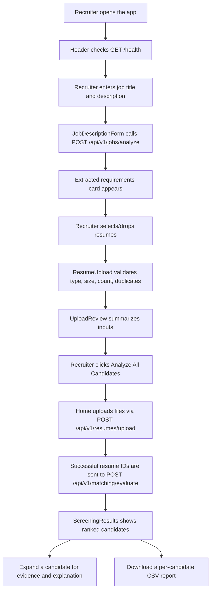

# 01 — Recruiter Workflow

This document explains what a recruiter can do in HireLens today and what each screen means. It is based on `frontend/app/page.tsx`, the components it renders, and the backend routes they call.

## End-to-end journey

A screening session has four stages:

1. **Describe the role.** Enter a job title and paste the job description, then analyze it.
2. **Add resumes.** Select or drop up to 10 PDF or DOCX files, each up to 10 MB.
3. **Review and screen.** Confirm the inputs, then upload and evaluate all candidates.
4. **Inspect and export.** Review the ranked table, expand candidates for evidence, and download a CSV report.

## Stage 1 — Describe the role

`frontend/components/job-description-form.tsx` provides:

- a required **Job Title** text input
- a required **Job Description** textarea
- an **Analyze Job Description** button

Both fields must be non-empty. The button calls `apiClient.analyzeJob({ job_description: description })`; the title is held in parent state for display and review. The backend endpoint is `POST /api/v1/jobs/analyze`.

After a successful call, the form displays an **Extracted Requirements** card with:

- required skills, or `None detected`
- preferred skills, when present
- qualifications, when present
- experience required, when it is not `Not specified`

Internally, the frontend receives a `job_id` and an `AnalyzedJobDescription`. The job ID is required for the later screening call. The analysis is also used by the review screen as a flag that a JD was analyzed.

What the backend does at this stage is described in [03 — Backend Internals](./03_BACKEND_INTERNALS.md) and [05 — AI and NLP Matching](./05_AI_NLP_MATCHING.md).

## Stage 2 — Add resumes

`frontend/components/resume-upload.tsx` accepts PDF and DOCX files by click-to-browse or drag and drop. Client-side checks enforce:

| Rule | Limit |
|---|---|
| File types | PDF (`application/pdf`) and DOCX (`application/vnd.openxmlformats-officedocument.wordprocessingml.document`) |
| Maximum size per file | 10 MB |
| Maximum number of files | 10 |
| Duplicates | Rejected when name and size match an already selected file |

Rejected files are reported with a browser `alert()`. Accepted files appear in a list with `pending` status and can be removed before screening.

The hidden file input uses `accept=".pdf,.docx"`; the actual validation is MIME-based. There is no percentage progress bar.

## Stage 3 — Review and screen

`frontend/components/upload-review.tsx` shows the job title, whether a description is present, the selected files, file sizes, and per-file status. The **Analyze All Candidates** button becomes enabled when:

- the job title is non-empty,
- a JD analysis has completed,
- at least one file is present,
- screening is not already in progress.

When the recruiter clicks the button, `Home.handleAnalyze` in `frontend/app/page.tsx`:

1. sets the screening state,
2. uploads the files as multipart field `files` to `POST /api/v1/resumes/upload`,
3. maps each upload result back to the corresponding file by array index,
4. collects the successful `resume_id` values,
5. calls `POST /api/v1/matching/evaluate` with `use_semantic: true`,
6. stores the returned `MatchingResponse`.

A spinner from `frontend/components/screening-progress.tsx` is shown while this runs. If no resumes upload successfully, an inline error appears. Per-file failures remain visible in the review list.

## Stage 4 — Interpret the results

`frontend/components/screening-results.tsx` renders a table with:

| Column | Meaning |
|---|---|
| Rank | Position in the backend-sorted result list. |
| Candidate | Resume filename. |
| Match Score | `overall_score` from the backend, shown to one decimal place. |
| Skills Matched | `matched_skills.length / (matched_skills.length + missing_skills.length)`. |
| Action | Expand details or download a CSV report. |

The frontend does not sort or filter. The backend sorts candidates by `overall_score` descending.

Score presentation uses fixed UI thresholds:

- 80 or above: **High** / green
- 60–79.9: **Medium** / yellow
- below 60: **Low** / red

These thresholds are presentation labels in `screening-results.tsx` and `candidate-analysis.tsx`; they are not a separate backend classification model.

Failed candidates remain in the table with `Not evaluated`, the error text, and `Unavailable` for export.

### Expanded candidate view

Clicking a row expands `frontend/components/candidate-analysis.tsx`, which shows:

- scoring strategy and semantic availability
- required, preferred, semantic, and evidence score breakdown
- alternative requirement groups and whether they were satisfied
- matched skills with expandable evidence snippets
- strengths and gaps
- missing and additional skills
- the backend-generated explanation
- a recruiter interpretation label and decision-support disclaimer

Evidence snippets show where a skill appeared, its strength, demonstration level, and supporting text. A measurable project or experience bullet is treated differently from a bare skills-list claim; the scoring details are in [05 — AI and NLP Matching](./05_AI_NLP_MATCHING.md).

### Exporting a report

The **Download** button calls `apiClient.generateReport(jobId, resumeId, 'csv')`. The backend regenerates the evaluation and returns report content; the browser turns it into a downloaded `.csv` file named from the original resume filename.

The client method supports both JSON and CSV, but the visible UI currently offers CSV only. Reports are not persisted in a database table.

## What the recruiter should know

- The score is decision support, not a predicted hiring outcome.
- The live system uses heuristic parsing, structured skill matching, MiniLM semantic similarity, and evidence scoring. It does not use an LLM.
- Years of experience and qualifications are shown as context but are not a separate weighted score component.
- If the semantic model is unavailable, the backend continues with renormalized weights and records the fallback in the scoring strategy metadata.
- Scanned PDFs with little extractable text are flagged by the parser; OCR is not performed.
- There is no authentication, candidate history, or saved recruiter workspace in the current implementation.

Proposed product improvements are listed in [12 — Future Improvements](./12_FUTURE_IMPROVEMENTS.md).
