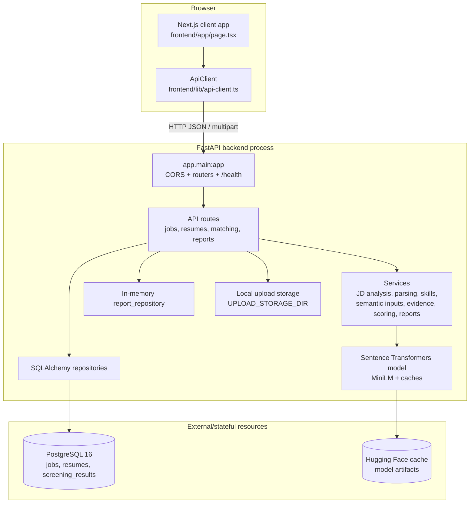

# 02 — System Architecture

## Architectural style

HireLens is a client/server application with a clearly separated frontend and backend:

- The **browser** runs the Next.js client page and calls the backend over HTTP.
- The **FastAPI backend** owns parsing, matching, scoring, persistence, and report generation.
- **PostgreSQL** stores jobs, resumes, and screening results.
- The **local filesystem** stores uploaded resume files.
- The **Hugging Face cache / local model environment** supplies the optional MiniLM semantic model.
- An **in-memory repository** holds generated reports for the lifetime of the backend process.

The codebase also contains a legacy Streamlit application under `app.py` and `src/`. It is not mounted by the FastAPI backend and is not part of the live architecture.



## Backend composition

### Application entry point

`backend/app/main.py` creates the FastAPI application:

```python
app = FastAPI(
    title=settings.APP_NAME,
    description="AI-powered resume screening and job matching backend API",
    version=settings.APP_VERSION,
    lifespan=lifespan,
)
```

The lifespan function:

- calls `init_database()` at startup,
- yields control to the application,
- calls `close_database()` at shutdown.

`init_database()` in `backend/app/db/database.py` creates the async SQLAlchemy engine and session factory. It does not create tables, run Alembic, or check connectivity. Schema changes are managed separately through `backend/alembic/`.

`backend/app/main.py` imports `torch` early to reduce Windows DLL conflicts with semantic dependencies. A failed import is logged and semantic matching can fall back.

### Middleware and routers

The only registered middleware is `CORSMiddleware`:

- allowed origins come from `settings.CORS_ORIGINS`
- credentials are allowed
- all methods and headers are allowed by default configuration

Routers are mounted under `settings.API_PREFIX`, which defaults to `/api/v1`:

| Router module | Mount path |
|---|---|
| `backend/app/api/routes/resumes.py` | `/api/v1/resumes` |
| `backend/app/api/routes/jobs.py` | `/api/v1/jobs` |
| `backend/app/api/routes/matching.py` | `/api/v1/matching` |
| `backend/app/api/routes/reports.py` | `/api/v1/reports` |

`GET /health` is registered directly in `main.py`. There is no root `/` endpoint, no authentication dependency, no rate limiting, no request-ID middleware, and no global exception handler. `ErrorResponse` exists in `backend/app/schemas/common.py` but is not wired into a handler.

The health endpoint returns static liveness data (`status`, `version`, `app_name`). It does not call `check_database_connectivity()`.

### Service layers

`backend/app/services/` contains the business logic. It can be grouped as follows:

| Concern | Important modules |
|---|---|
| Job analysis | `job_analysis_service.py` |
| Document extraction | `document_service.py`, `file_storage_service.py` |
| Resume parsing | `resume_parser_service.py`, `section_detection_service.py` |
| Skills | `skill_service.py`, `backend/app/data/skill_hierarchy.py`, `backend/app/data/skills.json` |
| Enrichment | `experience_classification_service.py`, `project_intelligence_service.py`, `temporal_service.py`, `experience_relevance_service.py` |
| Semantic pipeline | `semantic_input_service.py`, `semantic_matching_service.py`, `requirement_semantic_service.py` |
| Evidence | `evidence_extraction_service.py`, `evidence_mapping_service.py` |
| Scoring/orchestration | `scoring_service.py`, `candidate_evaluation_service.py` |
| Reporting | `report_service.py` |
| Legacy | `matching_service.py`, `keyword_stuffing_detector.py` |

`backend/app/utils/text_processor.py` supplies normalization and segmentation helpers, while `backend/app/utils/serialization.py` converts Pydantic models, dataclasses, enums, UUIDs, and dates into JSONB-safe values.

### Persistence architecture

Live routes use the SQLAlchemy repositories in `backend/app/repositories/`, not the dict-backed classes in `backend/app/core/repository.py`. The only in-memory repository still used by a live route is `report_repository`.

`backend/app/db/session.py::get_db` is the route dependency. It lazily initializes the database and yields an `AsyncSession`; routes commit or roll back explicitly. No automatic transaction wrapper is applied.

Additional details are in [06 — Database Design](./06_DATABASE_DESIGN.md).

## Frontend composition

The frontend has one route, `frontend/app/page.tsx`, and uses local React state only. Components are coordinated through props and callbacks; there is no global store or context.

The API boundary is `frontend/lib/api-client.ts::ApiClient`. It uses `fetch`, reads `NEXT_PUBLIC_BACKEND_URL` with a `http://localhost:8000` fallback, and performs no runtime schema validation.

Styling uses Tailwind CSS 4 with CSS-first tokens in `frontend/app/globals.css`. The application uses a system font stack; there is no `next/font` download.

Additional details are in [04 — Frontend Internals](./04_FRONTEND_INTERNALS.md).

## Runtime state and deployment boundary

| State | Location | Lifetime |
|---|---|---|
| Jobs, resumes, screening results | PostgreSQL tables | Persistent database storage |
| Uploaded PDF/DOCX files | `UPLOAD_STORAGE_DIR`, default `storage/uploads` | Persistent only if the directory is persisted externally |
| Generated reports | `backend/app/core/repository.py::report_repository` | Process memory; lost on restart |
| Embedding caches | `SemanticMatchingService` bounded LRU caches | Process memory |
| Model artifacts | Hugging Face cache / local environment | External to the app process |
| UI workflow state | React component state | Browser session/page lifetime |

`docker-compose.yml` defines only a `postgres` service using `postgres:16`, port `5432`, and a named `postgres_data` volume. It does not define backend or frontend containers, and it does not provision a volume for uploads or the model cache.

## Principal request flows

### Read flow: connection status

```text
Header (useEffect + 30s interval)
  → apiClient.healthCheck()
  → GET /health
  → static HealthResponse
```

### Write flow: job analysis

```text
JobDescriptionForm.handleAnalyze
  → POST /api/v1/jobs/analyze
  → routes.jobs.analyze_job
  → job_analysis_service.analyze_job_description
  → JobRepository.create
  → PostgreSQL jobs row
```

### Write flow: resume upload

```text
Home.handleAnalyze
  → POST /api/v1/resumes/upload (multipart files)
  → routes.resumes.upload_resumes
  → document_service.validate_file / extract_text
  → resume_parser_service.extract_all
  → skill_service.extract_skills + enrichment services
  → file_storage_service.save_file
  → ResumeRepository.create
  → PostgreSQL resumes row
```

### Compute flow: candidate evaluation

```text
Home.handleAnalyze
  → POST /api/v1/matching/evaluate
  → routes.matching.evaluate_matching
  → CandidateEvaluationService.evaluate_candidate
  → ScoringService.compute_match
  → structured + semantic + evidence signals
  → ScreeningRepository.upsert
  → sort results descending by overall_score
  → MatchingResponse
```

### Compute flow: report generation

```text
ScreeningResults.handleExport
  → POST /api/v1/reports/generate?job_id=...&resume_id=...&format=csv
  → routes.reports.generate_report
  → CandidateEvaluationService / ScoringService (same pipeline)
  → report_service.generate_csv_report
  → report_repository.save
  → ReportResponse with content string
```

## Cross-cutting characteristics

- **Single canonical scoring pipeline.** Both matching and reports use `CandidateEvaluationService` and `ScoringService`.
- **Graceful optional semantics.** Semantic failure is represented as status and fallback metadata instead of failing the request.
- **Mixed persistence.** Core entities are in PostgreSQL; reports and caches are process-local.
- **Heuristic parsing.** Resume fields, sections, skills, and evidence are based on regexes, curated lists, and section detection rather than a learned extraction model.
- **No identity layer.** There are no users, roles, or per-recruiter data isolation.
- **No background workers.** All parsing, embedding, scoring, and reporting happen synchronously inside request handlers.

## Architectural constraints to remember

1. `DATABASE_URL` is a computed property from `POSTGRES_*` settings; setting an environment variable named `DATABASE_URL` does not configure the application.
2. `TEST_DATABASE_URL` is only for tests and must never be the main database.
3. `UPLOAD_STORAGE_DIR` is resolved from the backend process working directory unless an absolute path is supplied.
4. `SEMANTIC_MODEL_NAME` and `SEMANTIC_MODEL_REVISION` are read directly with `os.getenv`, not through the `Settings` class.
5. The old 30/40/30 formula in `backend/app/services/matching_service.py::compute_match` and the legacy Streamlit app are not the live API scoring path.

Detailed endpoint semantics are in [07 — API Reference](./07_API_REFERENCE.md), and operational gaps are in [10 — Deployment and Operations](./10_DEPLOYMENT_OPERATIONS.md).
