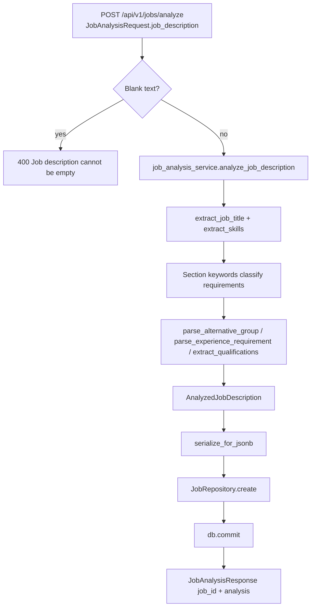
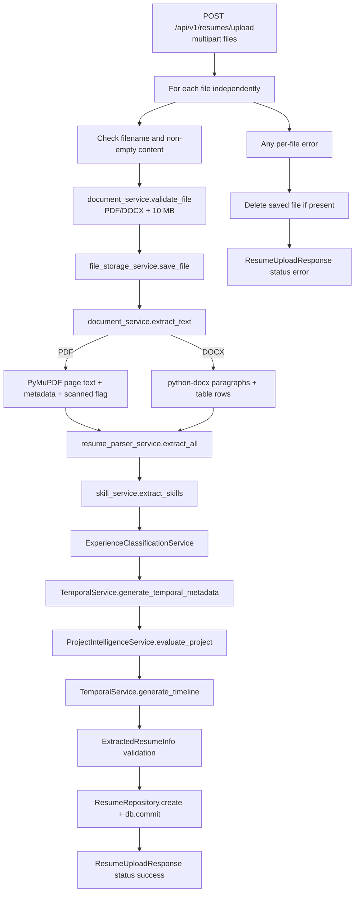

# 03 — Backend Internals

This document traces the implemented backend from HTTP request to persistence. It focuses on `backend/app/`, with emphasis on routes, services, and orchestration.

## Backend layout

| Area | Location | Role |
|---|---|---|
| Application entry | `backend/app/main.py` | FastAPI app, CORS, router registration, `/health`, lifespan. |
| Routes | `backend/app/api/routes/` | HTTP handlers for jobs, resumes, matching, and reports. |
| Schemas | `backend/app/schemas/` | Pydantic request and response models. |
| Services | `backend/app/services/` | Parsing, enrichment, matching, scoring, reporting. |
| Data | `backend/app/data/` | Curated skills database and skill hierarchy registry. |
| Core | `backend/app/core/` | Settings, exceptions, in-memory repositories. |
| Database | `backend/app/db/` | SQLAlchemy engine, sessions, declarative base. |
| Models/repositories | `backend/app/models/`, `backend/app/repositories/` | ORM entities and database queries. |
| Utilities | `backend/app/utils/` | Text processing and JSONB serialization. |
| Evaluation tools | `backend/app/evaluation/` | Experimental benchmark and metric utilities, not live routes. |

## Application startup

`backend/app/main.py`:

1. Imports `torch` early in a `try/except` to reduce Windows DLL conflicts. Import failure is logged and does not prevent app startup.
2. Creates the FastAPI app with `settings.APP_NAME`, a fixed description, `settings.APP_VERSION`, and a lifespan.
3. Adds `CORSMiddleware` using `settings.CORS_ORIGINS`, with credentials, all methods, and all headers.
4. Includes routers under `settings.API_PREFIX` (default `/api/v1`).
5. Registers `GET /health`.

The lifespan calls `init_database()` at startup and `await close_database()` at shutdown. It does not create tables, run Alembic, or check database connectivity.

## Job description workflow

`backend/app/services/job_analysis_service.py::analyze_job_description` scans the JD line by line.

Implemented extraction behavior:

- `extract_job_title` looks for role keywords in early non-contact lines.
- `skill_service.extract_skills` matches text against `backend/app/data/skills.json`.
- section keywords set the current requirement class:
  - required: `required`, `must have`, `essential`, `mandatory`, `need`, `should have`
  - preferred: `preferred`, `nice to have`, `bonus`, `plus`, `advantageous`, `desired`
  - optional: `optional`, `a plus`, `added advantage`
- `parse_alternative_group` detects patterns such as “Python, Java, or JavaScript” and emits a `REQUIRED_GROUP` in required sections. The current parser emits `match_mode = ANY`; `ALL` is supported by the schema and scorer but is not currently produced by JD analysis.
- `parse_experience_requirement` and `extract_required_experience` capture experience metadata and the legacy experience string.
- `extract_qualifications` captures qualification text.
- `parse_fundamental_requirement` and `is_fundamental_skill` mark fundamentals such as data structures, algorithms, OOP, DBMS, OS, networks, and problem solving.
- If no sectioned required or preferred skills are found, all detected technical skills are treated as required for backward compatibility.

`backend/app/api/routes/jobs.py::analyze_job` validates the request, calls the service, serializes the structured payloads, persists a `Job` row through `JobRepository.create`, and commits. Exceptions after validation produce `500 Failed to analyze job description`.

`GET /api/v1/jobs/{job_id}` rebuilds an `AnalyzedJobDescription` from `analysis_data`, overrides `structured_requirements` using `backend/app/repositories/job_repository.py::get_structured_requirements`, and fills missing fields from dedicated `Job` columns.

## Resume upload and parsing workflow

`backend/app/api/routes/resumes.py::upload_resumes` processes files independently and still returns HTTP 200 when every file fails. Failures are per-file `ResumeUploadResponse` records.

Key services:

- `backend/app/services/document_service.py::validate_file` checks empty content, `.pdf`/`.docx`, and a 10 MB limit.
- `extract_text_from_pdf` uses `pymupdf` (`fitz`) and sets `is_scanned` when average text per page is under 30 characters or there are no pages.
- `extract_text_from_docx` uses `python-docx` to read paragraphs and table cells.
- `extract_text` dispatches by extension and raises a plain `ValueError` for unsupported input.
- `backend/app/services/resume_parser_service.py::extract_all` extracts name, email, phone, education, experience, certifications, and projects with section patterns and regexes.
- `backend/app/services/skill_service.py::extract_skills` returns technical and soft skills; the route stores their union in `candidate_info.skills`.
- `backend/app/services/experience_classification_service.py::ExperienceClassificationService` classifies experience entries.
- `backend/app/services/temporal_service.py::TemporalService` adds start/end dates, duration months, recency, temporal status, and date confidence, then generates a timeline.
- `backend/app/services/project_intelligence_service.py::ProjectIntelligenceService.evaluate_project` adds relevance, complexity, implementation evidence, and measurable outcomes.

`backend/app/services/file_storage_service.py::FileStorageService` writes files with a UUID-based key. The global service uses `settings.UPLOAD_STORAGE_DIR`, default `storage/uploads`, relative to the backend process working directory.

`get_resume` rebuilds `DocumentExtractionResult` from stored text, `file_type`, and candidate-info keys. It does not restore DOCX `num_paragraphs`.

## Matching orchestration

`backend/app/api/routes/matching.py::evaluate_matching` is the main evaluation endpoint.

Inputs:

- `job_id` and `resume_ids` from `MatchingRequest`
- `use_semantic`, defaulting to `true`

Behavior:

1. Validate the job UUID; `400` for invalid format and `404` if missing.
2. Deduplicate resume IDs with `list(dict.fromkeys(...))`.
3. Skip invalid resume UUIDs in the lookup, but still include them as failed results.
4. Load found resumes with `ResumeRepository.get_by_ids`.
5. Build each `CandidateEvaluationContext` using stored resume text, job text, flat and structured skills, `use_semantic`, experience metadata, project metadata, and structured requirements.
6. Configure scoring with `ScoringConfig(keyword_stuffing_education_aware=True, related_skill_credit_threshold=0.5)`.
7. Call `backend/app/services/candidate_evaluation_service.py::CandidateEvaluationService.evaluate_candidate`.
8. Convert the returned dataclass to `MatchResult` with `dataclasses.asdict`.
9. Upsert a `ScreeningResult` through `ScreeningRepository.upsert` and commit per successful candidate.
10. Sort by `overall_score` descending and return `MatchingResponse`.

Missing resumes become zero-score results with `error: "Resume not found"`. Per-candidate exceptions become zero-score results with `error: "Matching process failed"` and trigger rollback.

### `CandidateEvaluationService`

`backend/app/services/candidate_evaluation_service.py` defines:

- `CandidateEvaluationContext`
- `CandidateEvaluationResult`
- `CandidateEvaluationService`
- `ALGORITHM_VERSION = "3.0.0-unified-evaluation"`

`evaluate_candidate` calls `ScoringService.compute_match`, extracts temporal metadata with `_extract_temporal_metadata`, overwrites the scoring strategy's `algorithm_version` with `3.0.0-unified-evaluation`, and adds `evaluation_date`. This is why API responses show 3.0.0 even though `ScoringService.ALGORITHM_VERSION` is `2.1.1-fairness-improved`.

`evaluate_batch` exists but is not used by HTTP routes.

`_extract_temporal_metadata` aggregates experience/project duration, recency, and status information and calls `TemporalService.generate_timeline`.

## Scoring entry point

`backend/app/services/scoring_service.py::ScoringService.compute_match` is the canonical scorer for both `/matching/evaluate` and `/reports/generate`.

It:

1. Extracts skill evidence through `EvidenceExtractionService`.
2. Chooses structured requirements via `get_structured_requirements`, with a flat-list fallback.
3. Computes required and preferred coverage through `skill_service`.
4. Computes an evidence score from required scoring units only.
5. Resolves exactly one semantic status: `used`, `disabled`, `model_unavailable`, `inference_failed`, or `empty_text`.
6. Optionally computes TF-IDF, which has weight 0.0 by default.
7. Computes the weighted overall score with effective weights.
8. Builds requirement evaluations, strengths, gaps, and a natural-language explanation.

The formula and its components are documented in detail in [05 — AI and NLP Matching](./05_AI_NLP_MATCHING.md).

## Report generation

`backend/app/api/routes/reports.py::generate_report` accepts `job_id`, `resume_id`, and `format` as **query parameters**, not a JSON body. `backend/app/schemas/api.py::ReportRequest` exists but is unused.

Behavior:

1. Validate `format`, UUIDs, and existence of job and resume.
2. Build a `CandidateEvaluationContext` with `use_semantic=True` hardcoded.
3. Evaluate through the same `CandidateEvaluationService` and config used by matching.
4. Render with `backend/app/services/report_service.py::generate_json_report` or `generate_csv_report`.
5. Save the content through `report_repository.save`.
6. Return `ReportResponse(report_id, format, content)`.

`generate_json_report` includes timestamp, job title, candidate info, match summary, full match result, and improvement suggestions. `generate_csv_report` produces a three-column `Category, Metric / Field, Value` report.

`GET /api/v1/reports/{report_id}` reads the in-memory store. Reports are not persisted in PostgreSQL.

## Error and transaction handling

- `get_db` yields a session but does not commit or roll back.
- Jobs, resumes, and matching routes commit explicitly.
- Upload rollback occurs only in the generic exception branch.
- Matching rollback occurs on per-candidate exceptions.
- Reports do not call rollback on evaluation failure.
- There are no global exception handlers.
- `ErrorResponse` in `backend/app/schemas/common.py` is defined but unused.
- Domain exceptions in `backend/app/core/exceptions.py` exist, but current `document_service` mostly raises plain `ValueError`, so some typed upload branches are effectively unreachable.

## Legacy and unused backend code

These should not be confused with the live pipeline:

- `backend/app/services/matching_service.py::compute_match` uses an older `0.3 TF-IDF + 0.4 semantic + 0.3 skill` formula, or `0.5 TF-IDF + 0.5 skill` without semantic. It is not used by `/matching/evaluate` or `/reports/generate`. Only `tfidf_similarity` from this module is imported by the live scorer, and its weight is 0.0.
- `backend/app/core/repository.py` contains dict-backed resume and job repositories from an earlier stage. Only `report_repository` is used by a live route.
- `backend/app/services/experience_relevance_service.py` has no live imports outside its own module/tests.
- Root `app.py` and `src/` form a legacy Streamlit application using the older formula and local session state. They are not mounted by FastAPI.

## File and symbol index

| Concern | Files and functions |
|---|---|
| App setup | `backend/app/main.py::app`, `lifespan`, `health_check` |
| Job route | `backend/app/api/routes/jobs.py::analyze_job`, `get_job` |
| Resume route | `backend/app/api/routes/resumes.py::upload_resumes`, `get_resume` |
| Matching route | `backend/app/api/routes/matching.py::evaluate_matching` |
| Report route | `backend/app/api/routes/reports.py::generate_report`, `get_report` |
| JD analysis | `backend/app/services/job_analysis_service.py::analyze_job_description`, `extract_job_title`, `parse_alternative_group`, `parse_experience_requirement`, `extract_qualifications` |
| Document handling | `backend/app/services/document_service.py::validate_file`, `extract_text`, `extract_text_from_pdf`, `extract_text_from_docx` |
| Resume parsing | `backend/app/services/resume_parser_service.py::extract_all`, `extract_name`, `extract_email`, `extract_phone`, `extract_education`, `extract_experience`, `extract_certifications`, `extract_projects` |
| Storage | `backend/app/services/file_storage_service.py::FileStorageService`, `file_storage_service` |
| Orchestration | `backend/app/services/candidate_evaluation_service.py::CandidateEvaluationService.evaluate_candidate` |
| Scoring | `backend/app/services/scoring_service.py::ScoringService.compute_match` |
| Reports | `backend/app/services/report_service.py::generate_json_report`, `generate_csv_report` |
| Persistence | `backend/app/repositories/job_repository.py`, `resume_repository.py`, `screening_repository.py` |
| Serialization | `backend/app/utils/serialization.py::serialize_for_jsonb` |
