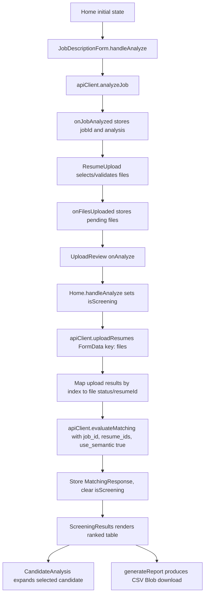

# 04 — Frontend Internals

## Scope and stack

The frontend is a single-page Next.js application under `frontend/`. The only page is `frontend/app/page.tsx`, which is a client component (`"use client"`). There are no additional routes, API routes, loading pages, or error pages.

Key dependencies from `frontend/package.json`:

- `next` 16.4.6, `react` 19.3.0, `react-dom` 19.3.0
- TypeScript 5 with strict mode
- Tailwind CSS 4.3.3 with `@tailwindcss/turbopack`
- `lucide-react` for icons
- `clsx`, `tailwind-merge`, `class-variance-authority`, and `@radix-ui/react-slot`

Scripts are `dev`, `build`, `start`, and `lint`. There is no frontend `test` script and no frontend test tooling.

## Application shell

`frontend/app/layout.tsx` exports:

- `metadata` with title `HireLens - AI Resume Screening Platform` and a description of AI-powered resume screening.
- `RootLayout`, which wraps children in `<html lang="en" className="antialiased">` and `<body className="min-h-screen bg-background text-foreground">`.

`frontend/app/globals.css` uses Tailwind CSS 4's CSS-first configuration:

- `@import "tailwindcss";`
- an `@theme` block mapping background, foreground, card, popover, primary, secondary, muted, accent, destructive, border, input, ring, and radius tokens
- light and `.dark` HSL custom properties in `@layer base`
- a system sans-serif `font-family` stack for `body`

There is no `next/font` import or custom font download. `frontend/lib/utils.ts` provides `cn()`, which composes `clsx` and `tailwind-merge`.

`frontend/next.config.ts` enables `cacheComponents`, `partialPrefetching`, and a Turbopack CSS rule for `@tailwindcss/turbopack`. The `@/*` path alias points to the frontend root via `frontend/tsconfig.json`.

## Component map

| File | Exported symbol | Responsibility |
|---|---|---|
| `frontend/app/page.tsx` | `Home` | Owns workflow state and orchestrates all API calls. |
| `frontend/components/header.tsx` | `Header` | Displays branding and backend connection status. |
| `frontend/components/job-description-form.tsx` | `JobDescriptionForm` | Collects job title/description and calls job analysis. |
| `frontend/components/resume-upload.tsx` | `ResumeUpload` | Selects, validates, displays, and removes resume files. |
| `frontend/components/upload-review.tsx` | `UploadReview` | Summarizes inputs and starts screening. |
| `frontend/components/screening-progress.tsx` | `ScreeningProgress` | Shows a spinner while screening is in flight. |
| `frontend/components/screening-results.tsx` | `ScreeningResults` | Renders the ranked table, failures, and CSV export. |
| `frontend/components/candidate-analysis.tsx` | `CandidateAnalysis` | Expands one candidate into scores, evidence, strengths, gaps, and explanation. |
| `frontend/components/ui/button.tsx` | `Button`, `buttonVariants` | shadcn-style button primitive with `cva` variants. |
| `frontend/components/ui/card.tsx` | `Card` and subcomponents | shadcn-style card primitives. |
| `frontend/components/ui/table.tsx` | `Table` and subcomponents | shadcn-style table primitives. |

The three `frontend/components/ui/` primitive files are currently unused by the application; visible UI is hand-written Tailwind markup.

## Main workflow in `Home`

`Home` in `frontend/app/page.tsx` holds seven state values:

- `jobTitle`
- `jobId`
- `jobAnalysis`
- `uploadedFiles`
- `isScreening`
- `screeningResults`
- `screeningError`

It coordinates the workflow through callback props rather than a global store:

1. `JobDescriptionForm` calls `onJobAnalyzed(jobId, analysis)`; `Home` stores the job ID and analysis and clears prior results.
2. `ResumeUpload` calls `onFilesUploaded(files)`; `Home` stores `UploadedFile` entries and clears prior results.
3. `UploadReview` calls `onAnalyze`; `Home.handleAnalyze` performs upload and matching.
4. `ScreeningResults` receives the `MatchingResponse` and the active `jobId`.



### `handleAnalyze` details

`Home.handleAnalyze` checks that `jobId` and at least one file exist, sets `isScreening`, clears prior results and errors, and builds `FormData` by appending every `u.file` under the key `files`.

It calls `apiClient.uploadResumes(formData)` and maps `uploadResponse.results[index]` back to the corresponding uploaded file:

- success → `status: 'success'` and `resumeId = result.resume_id`
- failure → `status: 'error'` and an error message from `result.error`, `result.message`, or a generic fallback
- missing result → `No upload result returned by the server`

Successful resume IDs are passed to `apiClient.evaluateMatching({ job_id, resume_ids, use_semantic: true })`. If no resume uploads succeed, the UI throws `No resumes were successfully uploaded`. The final `MatchingResponse` is stored in `Home` and rendered by `ScreeningResults`.

## Individual components

### `Header`

`Header` calls `apiClient.healthCheck()` once on mount and every 30 seconds using `setInterval`. It maps the result to `ConnectionStatus`: `checking`, `connected`, or `disconnected`. The status badge is informational; it does not block any workflow action.

### `JobDescriptionForm`

`JobDescriptionForm` receives `jobTitle` and `setJobTitle` from `Home`, while `description`, `analysis`, `isAnalyzing`, and `error` are local state.

`handleAnalyze` requires both a non-empty title and description, then calls `apiClient.analyzeJob({ job_description: description })`. On success it stores the returned analysis locally and invokes `onJobAnalyzed(response.job_id, response.analysis)`. The result card shows detected required skills, preferred skills, qualifications, and experience when present.

There is no `<form>` element or submit handler; analysis starts through a button click.

### `ResumeUpload`

`ResumeUpload` defines client-side limits:

- `MAX_FILES = 10`
- `MAX_FILE_SIZE = 10 * 1024 * 1024`
- `ALLOWED_TYPES` containing PDF and DOCX MIME types

`validateFile` checks MIME type and size. `handleFileSelect` enforces the file count, rejects duplicate name-and-size pairs, accumulates messages, and reports them with `alert()`. New files are added as `{ file, status: 'pending' }`. The component also supports drag and drop and per-file removal.

The hidden input uses `accept=".pdf,.docx"`, while validation is MIME-based. The `UploadedFile` type defines an `uploading` status, but no code assigns it.

### `UploadReview`

`UploadReview` computes:

```ts
canAnalyze =
  jobTitle.trim() !== '' &&
  hasJobDescription &&
  files.length > 0 &&
  !disabled;
```

It summarizes the job title, presence of a description, and each selected file before enabling the `Analyze All Candidates` button. It does not require every file to have upload status `success`.

### `ScreeningProgress`

`ScreeningProgress` returns `null` when `isScreening` is false. Otherwise it renders a spinner with the text `Screening Candidates` and `Analyzing resumes against job requirements...`. It has no percentage or step count.

### `ScreeningResults`

`ScreeningResults` renders:

- summary counters from `total_candidates`, `successful`, and `failed`
- a plain HTML table with columns Rank, Candidate, Match Score, Skills Matched, and Action
- one row per candidate, including failed candidates
- expandable detail rows containing `CandidateAnalysis`
- a CSV download button per successful candidate

The rank is the array index plus one. The frontend does not sort results; the backend sorts them by `overall_score` descending in `backend/app/api/routes/matching.py::evaluate_matching`.

Score labels use thresholds of 80 and 60:

- `>= 80` → High / green
- `>= 60` → Medium / yellow
- otherwise → Low / red

`handleExport(candidate, format = 'json')` calls `apiClient.generateReport(jobId, candidate.resume_id, format)`, wraps `report.content` in a `Blob`, creates an object URL, and clicks a temporary anchor. The visible button always passes `'csv'`.

### `CandidateAnalysis`

`CandidateAnalysis` renders the expanded detail view for one `CandidateMatchResult`. It reads `match_result` and shows:

1. **Scoring Strategy** — `algorithm_version`, components, semantic availability, and a fallback warning when `semantic_available` is false.
2. **Score Breakdown** — required and preferred coverage, semantic score when non-null, and evidence score.
3. **Alternative Requirements** — group name, satisfaction state, `match_mode`, required skills, and matched skills.
4. **Matched Skills** — per-skill accordion over `skill_evidence`, showing section, strength, demonstration level, snippet, experience type, or project title.
5. **Strengths / Gaps** — lists from the backend result with fallback text.
6. **Missing Skills / Additional Skills** — chips; additional skills are capped at 10 with a `+N more` indicator.
7. **Why This Score** — the backend-generated explanation.
8. **Recruiter Interpretation** — Strong/Moderate/Limited Match labels based on the same 80/60 thresholds and a decision-support disclaimer.

There are no modals or dialogs; this is an inline expandable table row.

## API client

`frontend/lib/api-client.ts` defines `ApiClient` and exports a singleton `apiClient`. Its base URL comes from `NEXT_PUBLIC_BACKEND_URL`, defaulting to `http://localhost:8000`.

The private `request<T>` helper sets `Content-Type: application/json`, parses JSON, and throws an `Error` using the response `detail` field or an `HTTP <status>` fallback. There is no runtime schema validation.

| Method | Endpoint | Request | Return type |
|---|---|---|---|
| `healthCheck()` | `GET /health` | none | `HealthResponse` |
| `analyzeJob(request)` | `POST /api/v1/jobs/analyze` | `{ job_description }` | `JobAnalysisResponse` |
| `uploadResumes(formData)` | `POST /api/v1/resumes/upload` | multipart field `files` | `BatchResumeUploadResponse` |
| `evaluateMatching(request)` | `POST /api/v1/matching/evaluate` | `{ job_id, resume_ids, use_semantic }` | `MatchingResponse` |
| `generateReport(jobId, resumeId, format = 'json')` | `POST /api/v1/reports/generate` with `job_id`, `resume_id`, `format` query parameters | none | `ReportResponse` |

`uploadResumes` bypasses `request<T>` so the browser can set the multipart boundary. Report generation recomputes the match on the server; it does not reuse the displayed result object.

## Types and state management

`frontend/lib/types.ts` mirrors backend Pydantic schema names such as `HealthResponse`, `JobAnalysisResponse`, `BatchResumeUploadResponse`, `MatchingResponse`, `CandidateMatchResult`, `MatchResult`, `ScoringStrategy`, `SkillEvidence`, and `ReportResponse`. It also defines UI-only types such as `UploadedFile` and `ConnectionStatus`.

The mirroring is compile-time only and incomplete in places: the frontend `ScoringStrategy` omits backend fields including `configured_weights`, `semantic_status`, `semantic_model_available`, `semantic_error`, and `semantic_details`. There is no Zod or other runtime validation.

State management is local `useState` plus `useCallback` in `ResumeUpload` and prop drilling through `Home`. There is no context, reducer, external store, `useMemo`, `useRef`, request cache, retry, timeout, or abort logic. The `ScreeningState` type in `frontend/lib/types.ts` is unused.

## Loading, error, and empty states

| Situation | Behavior |
|---|---|
| Backend unreachable | `Header` shows a disconnected badge; interaction remains possible. |
| JD analysis in progress | `Sparkles` icon spins, label changes to `Analyzing...`, inputs are disabled. |
| Screening in progress | `ScreeningProgress` spinner appears; all inputs are disabled. |
| Per-file upload failure | Error appears in the file row and review list; file remains in the list. |
| Whole-operation failure | `Home` shows a red inline banner from `screeningError`. |
| Failed candidate | Red-tinted results row with `Not evaluated`, error text, and `Unavailable` action. |
| Empty result set | Centered `No results to display`. |
| Export failure | `console.error` and `alert('Failed to export report')`. |

## Known frontend limitations

- No frontend tests.
- No runtime validation of API payloads.
- No upload progress percentage; `'uploading'` status is unused.
- No sorting, filtering, or searching in the results table.
- Client validation errors use browser `alert()`.
- `canAnalyze` can be true when some uploads failed, as long as at least one file is present.
- Upload-result mapping is positional and assumes backend response order matches request order.
- `components.json` references a `tailwind.config.ts` that does not exist and an `@/hooks` alias with no corresponding directory.
- The `frontend/components/ui/` primitives are unused scaffolding.
- There is no theme toggle, although dark-mode CSS tokens are defined.

No frontend changes are proposed in this document; improvement ideas are collected in [12 — Future Improvements](./12_FUTURE_IMPROVEMENTS.md).
