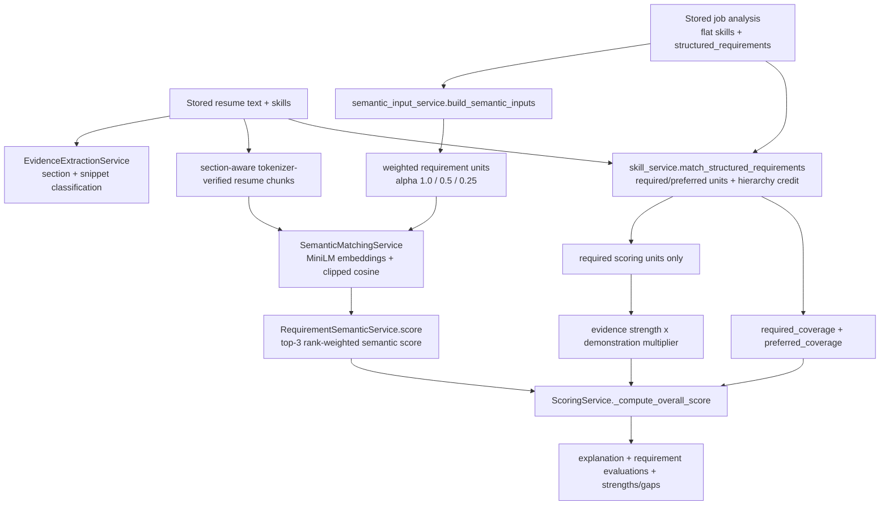
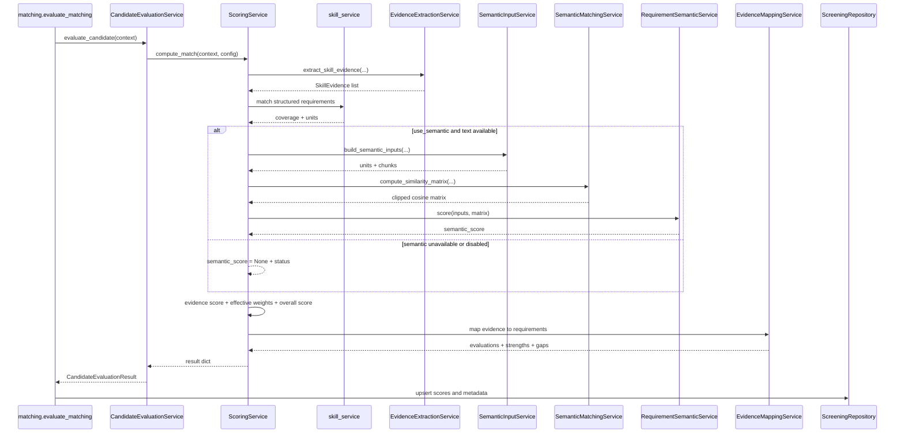

# 05 — AI and NLP Matching

This is the canonical explanation of how HireLens computes a match score. It is derived from the implemented pipeline in `backend/app/services/`, especially `candidate_evaluation_service.py` and `scoring_service.py`.

## What the system actually uses

Implemented:

- rule-based job description analysis
- curated skill extraction and a small skill relationship hierarchy
- section-aware resume parsing and evidence extraction
- a pinned `sentence-transformers/all-MiniLM-L6-v2` model with cosine similarity
- a deterministic weighted score with explicit fallback metadata

Not implemented:

- LLM-based scoring or generative evaluation
- fine-tuning
- a vector database
- OCR for scanned PDFs
- a dedicated experience or qualification score component

The older formula in `backend/app/services/matching_service.py::compute_match` is not the live API formula. Only `tfidf_similarity` is imported by the live scorer, and its configured weight is `0.0`.

## Matching pipeline



## Step 1 — Structured requirements and skill coverage

`backend/app/services/job_analysis_service.py::analyze_job_description` emits structured requirement types defined in `backend/app/schemas/job.py`:

| Type | Meaning in scoring |
|---|---|
| `REQUIRED` | Required scoring unit. |
| `FUNDAMENTAL` | Required scoring unit for fundamental concepts. |
| `REQUIRED_GROUP` | Alternative group; `ANY` and `ALL` are supported by the schema and scorer, but current JD analysis emits only `ANY`. |
| `PREFERRED` | Preferred scoring unit. |
| `OPTIONAL` | Metadata only. |
| `EXPERIENCE` | Metadata only. |

`backend/app/services/skill_service.py::match_structured_requirements` builds units of kind `individual`, `any`, and `all`. Structured requirements are authoritative when present; the flat required-skill list is only a fallback and is never unioned with them.

Skill matching uses:

- `backend/app/utils/text_processor.py::normalize_skill_name` for aliases such as `js → javascript` and `postgres → postgresql`
- `find_skill_occurrences` for punctuation-safe, longest-first matching
- `backend/app/data/skill_hierarchy.py::SkillHierarchyRegistry.get_match_credit`

Hierarchy credits:

| Relationship | Credit |
|---|---:|
| alias or equivalent | `1.0` |
| parent-child or related | `0.5` |
| distinct or unknown | `0.0` |

`ScoringConfig` defaults to `related_skill_credit_threshold=1.0`, but both live API routes set it to `0.5`, so related skills can receive partial credit through the API.

Coverage is computed from unit credits:

```text
required_coverage  = 100 × sum(required_unit_credit)  / number_of_required_units
preferred_coverage = 100 × sum(preferred_unit_credit) / number_of_preferred_units
```

An `ANY` group takes the maximum member credit. An `ALL` group takes the mean member credit and is fully satisfied only when every member has positive credit; this is implemented behavior, but current JD analysis produces only `ANY` groups. `skill_match_score` in the response is an alias of required coverage.

## Step 2 — Semantic matching

### Model and caches

`backend/app/services/semantic_matching_service.py` defines:

- `DEFAULT_MODEL_NAME = "sentence-transformers/all-MiniLM-L6-v2"`
- `VERIFIED_MODEL_REVISION = "1110a243fdf4706b3f48f1d95db1a4f5529b4d41"`
- `SEMANTIC_MODEL_NAME` and `SEMANTIC_MODEL_REVISION` environment overrides, read with `os.getenv`
- requirement embedding cache size `256`
- chunk embedding cache size `2048`
- cached embeddings keyed by model name, revision, and a normalized text hash
- `SemanticErrorType` values: `package_not_installed`, `import_failure`, `dll_dependency_failure`, `model_download_failure`, `model_loading_failure`, `inference_failure`

### Input construction

`backend/app/services/semantic_input_service.py` implements `requirement_chunk_v1` with `tail_and_section_anchors_v1` overflow behavior.

Important constants:

| Constant | Value |
|---|---:|
| `RELEVANCE_THRESHOLD` | `0.25` |
| `TOP_K` | `3` |
| `RANK_WEIGHTS` | `(1.00, 0.50, 0.25)` |
| `MAX_RESUME_CHUNKS` | `64` |
| `MAX_TAIL_CHUNKS` | `8` |
| `MAX_CONTEXT_REQUIREMENTS` | `8` |
| `MAX_SEMANTIC_DIAGNOSTICS` | `8` |
| `TOKEN_RESERVE` | `16` |

Requirement units receive alpha weights:

| Unit source | Alpha | Scored |
|---|---:|---|
| `REQUIRED`, `FUNDAMENTAL`, `REQUIRED_GROUP` | `1.0` | yes |
| `PREFERRED` | `0.5` | yes |
| extracted JD context lines | `0.25` | yes |
| `OPTIONAL`, `EXPERIENCE` | `0.0` | no |

Section retrieval priorities (`beta`) from `SECTION_BETA`:

| Section | Beta |
|---|---:|
| experience, projects | `1.0` |
| skills | `0.8` |
| summary | `0.6` |
| uncategorized | `0.5` |
| education, certifications, achievements, publications, awards | `0.4` |
| personal info | `0.0` |

`build_resume_chunks` creates section-labelled, tokenizer-verified chunks, skips personal info, deduplicates chunks, and enforces the 64-chunk cap while preserving tail chunks and section anchors.

### Retrieval and scalar score

`SemanticMatchingService.compute_similarity_matrix` embeds query units and chunks, computes cosine similarity with `sklearn.metrics.pairwise.cosine_similarity`, and clips values to `[0, 1]`.

`backend/app/services/requirement_semantic_service.py::RequirementSemanticService.score` then:

1. keeps chunks with `beta > 0` and similarity >= `0.25`,
2. ranks them by `beta × similarity`,
3. takes the top 3,
4. applies rank weights `1.00`, `0.50`, `0.25`,
5. aggregates group units with `ANY = max` or `ALL = mean`,
6. computes the alpha-weighted scalar:

```text
semantic_score = clamp(100 × Σ(alpha_i × q_i) / Σ(alpha_i), 0, 100)
```

## Step 3 — Evidence scoring

`backend/app/services/evidence_extraction_service.py::EvidenceExtractionService` detects where each skill appears in the resume and classifies evidence.

Evidence types include:

- `demonstrated_in_experience`
- `demonstrated_in_project`
- `demonstrated_in_internship`
- `listed_in_skills`
- `mentioned_in_education`
- `mentioned_in_certification`
- `incidental_mention`
- `uncategorized`

`backend/app/services/scoring_service.py::ScoringService._calculate_evidence_score` maps strength and demonstration level to numbers.

| Strength | Value |
|---|---:|
| `strong` | `100` |
| `moderate` | `75` |
| `basic` | `50` |
| `weak` | `25` |

| Demonstration level | Multiplier |
|---|---:|
| `measurable` | `1.2` |
| `implemented` | `1.1` |
| `mentioned` | `1.0` |
| `claimed` | `0.8` |
| none | `1.0` |

Evidence is calculated over **required scoring units only**. Individual units use `credit × strength`; `ANY` units use the best representative; `ALL` units use the mean of member contributions. The final evidence score is capped at 100.

`backend/app/services/evidence_mapping_service.py::EvidenceMappingService` turns the same units into requirement evaluations, an evidence summary, strengths, and gaps. Satisfied `ANY` groups are handled so unmatched alternatives are not reported as gaps.

A bare skills-list mention generally becomes basic strength with a claimed multiplier, while a measurable project or experience bullet can reach the upper end of the scale.

## Step 4 — Overall score

`ScoringConfig` in `backend/app/services/scoring_service.py` defines the live weights:

| Component | Default weight | Source signal |
|---|---:|---|
| Required skill coverage | `0.35` | `required_match["match_percentage"]` |
| Preferred skill coverage | `0.15` | `preferred_match["match_percentage"]` |
| Semantic similarity | `0.30` | `semantic_score` |
| Evidence | `0.20` | evidence score |
| TF-IDF | `0.0` | computed only if enabled; disabled by default |

When semantic scoring succeeds:

```text
overall_score = clamp(
    0.35 × required_coverage
  + 0.15 × preferred_coverage
  + 0.30 × semantic_score
  + 0.20 × evidence_score,
  0, 100
)
```

All inputs are already on a 0–100 scale.

Example:

| Signal | Value | Contribution |
|---|---:|---:|
| Required coverage | 80 | `28.0` |
| Preferred coverage | 60 | `9.0` |
| Semantic score | 75 | `22.5` |
| Evidence score | 70 | `14.0` |

```text
final score = 28.0 + 9.0 + 22.5 + 14.0 = 73.5 / 100
```

The keyword-stuffing penalty exists in `KeywordStuffingDetector`, but `use_keyword_stuffing_penalty=False` by default and neither live route enables it.

## Semantic fallback

`ScoringService.compute_match` records one semantic status in `scoring_strategy.semantic_status`:

| Status | Meaning |
|---|---|
| `used` | Semantic score was computed. |
| `disabled` | Request set `use_semantic = false`. |
| `model_unavailable` | Model or package load failed. |
| `inference_failed` | Model loaded but scoring raised an error. |
| `empty_text` | JD or resume text was blank. |

When no semantic score is available, `ScoringService._effective_weights` sets the semantic weight to zero and renormalizes the remaining weights. With default weights the denominator is `0.70`:

```text
required  = 0.35 / 0.70 = 0.5000
preferred = 0.15 / 0.70 = 0.2143
evidence  = 0.20 / 0.70 = 0.2857
```

Using the same example values:

```text
fallback score = 0.5000 × 80 + 0.2143 × 60 + 0.2857 × 70
               ≈ 72.9 / 100
```

`fallback_used` is `true` for `model_unavailable`, `inference_failed`, and `empty_text`. It is `false` for an explicit `disabled` request, even though the remaining weights are still renormalized. The response also records semantic availability, error details, configured weights, and effective weights in `scoring_strategy`.

## Candidate evaluation sequence



Both `/matching/evaluate` and `/reports/generate` use this sequence. `CandidateEvaluationService` sets the visible `algorithm_version` to `3.0.0-unified-evaluation`; `ScoringService.ALGORITHM_VERSION` itself is `2.1.1-fairness-improved`.

## Experience and qualifications

Implemented:

- JD experience text and qualifications are extracted and stored in `jobs`.
- Resume experience and project entries are classified, temporally annotated, and returned as metadata.
- Evidence snippets can be marked with experience type or project title.
- Generated strengths, gaps, explanations, and temporal metadata use that context.

Not implemented as a weighted score component:

- years of experience
- seniority
- degree or qualification level
- experience classification weights
- recency or duration months
- `ExperienceRelevanceService` relevance scores

`OPTIONAL` and `EXPERIENCE` structured requirements are diagnostic metadata in skill matching and non-scored semantic units with `alpha = 0.0`.

## Legacy formula

`backend/app/services/matching_service.py::compute_match` remains in the codebase but is not called by live routes:

```text
with semantic:    overall = 0.3 × tfidf + 0.4 × semantic + 0.3 × skill
without semantic: overall = 0.5 × tfidf + 0.5 × skill
```

This formula belongs to the older Streamlit-era implementation and must not be described as HireLens's current scoring behavior.

## Interpretation limits

- The score has not been validated against a human-labelled hiring outcome benchmark in the live pipeline.
- Heuristic extraction can miss unconventional resume formatting.
- Semantic similarity can match related wording without proving competency.
- Evidence scoring depends on section detection and skill occurrence detection.
- The model environment can change behavior; fallback metadata exists to disclose that situation.

Evaluation utilities and their limits are covered in [08 — Testing and Quality](./08_TESTING_QUALITY.md), with roadmap items in [12 — Future Improvements](./12_FUTURE_IMPROVEMENTS.md).
