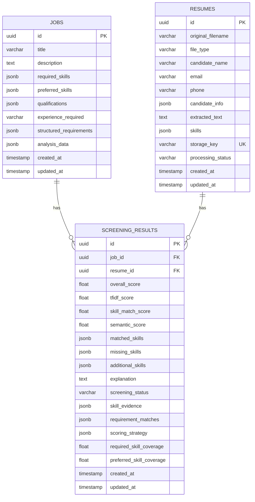

# 06 — Database Design

## Persistence overview

HireLens uses three PostgreSQL tables for durable application data:

- `jobs`
- `resumes`
- `screening_results`

ORM models live in `backend/app/models/`, shared mixins in `backend/app/db/base.py`, SQLAlchemy repositories in `backend/app/repositories/`, and migrations in `backend/alembic/versions/`.

Two important state stores are **not** tables:

- uploaded files are written to the local filesystem under `UPLOAD_STORAGE_DIR`
- generated reports are kept in `backend/app/core/repository.py::report_repository`, a process-local dictionary

## Entity relationship diagram

## Shared base and mixins

`backend/app/db/base.py` defines:

- `Base(DeclarativeBase)` — declarative ORM base.
- `UUIDMixin` — `id` as PostgreSQL `UUID(as_uuid=True)`, primary key, default `uuid4`.
- `TimestampMixin` — `created_at` and `updated_at`, both timezone-aware `DateTime` with `server_default=func.now()`; `updated_at` also uses `onupdate=func.now()`.

## Table: `jobs`

Model: `backend/app/models/job.py::Job`

| Column | Type | Notes |
|---|---|---|
| `id` | UUID | Primary key from `UUIDMixin`. |
| `title` | String(255) | Required. |
| `description` | String | Required; stores raw JD text. |
| `required_skills` | JSONB | Required, defaults to empty list. |
| `preferred_skills` | JSONB | Required, defaults to empty list. |
| `qualifications` | JSONB | Required, defaults to empty list. |
| `experience_required` | String(255) | Defaults to `"Not specified"`. |
| `structured_requirements` | JSONB | Required, defaults to empty list; added by the final migration. |
| `analysis_data` | JSONB | Required, defaults to empty dict; stores the full analyzed payload. |
| `created_at`, `updated_at` | timestamptz | From `TimestampMixin`. |

Indexes and relationships:

- `ix_jobs_title`
- `screening_results` relationship with `cascade="all, delete-orphan"`

Repository: `backend/app/repositories/job_repository.py::JobRepository` provides `create`, `get_by_id`, `get_all(limit=100, offset=0)`, and `delete`. `create` normalizes JSONB-bound values with `backend/app/utils/serialization.py::serialize_for_jsonb`.

`backend/app/repositories/job_repository.py::get_structured_requirements` prefers the dedicated `structured_requirements` column and falls back to `analysis_data["structured_requirements"]` for older rows.

## Table: `resumes`

Model: `backend/app/models/resume.py::Resume`

| Column | Type | Notes |
|---|---|---|
| `id` | UUID | Primary key. |
| `original_filename` | String(255) | Required. |
| `file_type` | String(50) | Required; `"pdf"` or `"docx"` from extraction. |
| `candidate_name` | String(255) | Optional. |
| `email` | String(255) | Optional and indexed. |
| `phone` | String(50) | Optional. |
| `candidate_info` | JSONB | Required; full `ExtractedResumeInfo` dump, including enrichment. |
| `extracted_text` | Text | Required. |
| `skills` | JSONB | Required; technical plus soft skills. |
| `storage_key` | String(255) | Required and unique. |
| `processing_status` | String(50) | Defaults to `"completed"`. |
| `created_at`, `updated_at` | timestamptz | From `TimestampMixin`. |

Indexes and relationships:

- `ix_resumes_email`
- `ix_resumes_candidate_name`
- `ix_resumes_processing_status`
- `screening_results` relationship with `cascade="all, delete-orphan"`

Repository: `backend/app/repositories/resume_repository.py::ResumeRepository` provides `create`, `get_by_id`, `get_by_ids`, `get_all(limit=100, offset=0)`, and `delete`. Repository methods flush and refresh but do not commit; routes commit.

### Local file storage

`backend/app/services/file_storage_service.py::FileStorageService` writes uploaded files with a UUID-based key and the original lowercase extension. The global `file_storage_service` is constructed with `settings.UPLOAD_STORAGE_DIR`, defaulting to `storage/uploads`.

Validation in the service allows `.pdf` and `.docx` and enforces 10 MB. `retrieve_file`, `delete_file`, and `get_file_path` reject storage keys containing path separators. On upload failure, the route attempts to delete any saved file.

There is no API route that serves an uploaded file back to the client.

## Table: `screening_results`

Model: `backend/app/models/screening_result.py::ScreeningResult`

| Column | Type | Notes |
|---|---|---|
| `id` | UUID | Primary key. |
| `job_id` | UUID | Foreign key to `jobs.id`, `ON DELETE CASCADE`. |
| `resume_id` | UUID | Foreign key to `resumes.id`, `ON DELETE CASCADE`. |
| `overall_score` | Float | Required. |
| `tfidf_score` | Float | Required; normally 0.0 in live responses. |
| `skill_match_score` | Float | Required; alias of required coverage. |
| `semantic_score` | Float | Optional; null when semantic scoring did not run. |
| `matched_skills` | JSONB | Required list. |
| `missing_skills` | JSONB | Required list. |
| `additional_skills` | JSONB | Required list. |
| `explanation` | Text | Required. |
| `screening_status` | String(50) | Defaults to `"completed"`. |
| `skill_evidence` | JSONB | Optional evidence map. |
| `requirement_matches` | JSONB | Optional requirement match details. |
| `scoring_strategy` | JSONB | Optional scoring metadata. |
| `required_skill_coverage` | Float | Defaults to 0.0. |
| `preferred_skill_coverage` | Float | Defaults to 0.0. |
| `created_at`, `updated_at` | timestamptz | From `TimestampMixin`. |

Constraints and indexes:

- unique constraint `uq_job_resume_screening` on `(job_id, resume_id)`
- `ix_screening_results_overall_score`
- `ix_screening_results_job_id`
- `ix_screening_results_resume_id`

Repository: `backend/app/repositories/screening_repository.py::ScreeningRepository` provides `create`, `upsert`, `get_by_id`, `get_by_job_and_resume`, `get_by_job_id` ordered by score descending, `get_by_resume_id`, and `delete`. The `/matching/evaluate` route uses `upsert`, so one candidate has at most one result per job.

Screening results are written by `/matching/evaluate` but are not exposed by a read route.

## Migration chain

Migrations are in `backend/alembic/versions/`:

1. `525a95dee632_initial_database_schema.py` — `revision="525a95dee632"`, `down_revision=None`. Creates `jobs`, `resumes`, and `screening_results` with core columns, indexes, foreign keys, and the unique `(job_id, resume_id)` constraint.
2. `add_evidence_fields.py` — `revision="add_evidence_fields"`, `down_revision="525a95dee632"`. Adds `skill_evidence`, `requirement_matches`, `required_skill_coverage`, `preferred_skill_coverage`, and `scoring_strategy` to `screening_results`.
3. `add_structured_requirements.py` — `revision="add_structured_requirements"`, `down_revision="add_evidence_fields"`. Adds `jobs.structured_requirements`; this is the head revision.

`backend/alembic/env.py` imports `Base`, `Job`, `Resume`, and `ScreeningResult`, sets target metadata to `Base.metadata`, enables `compare_type`, and sets `sqlalchemy.url` from `settings.DATABASE_URL`.

Application startup calls `init_database()` but does not run Alembic or `Base.metadata.create_all()`.

## Database engine and sessions

`backend/app/db/database.py` provides:

- `engine` and `AsyncSessionLocal` module globals
- `init_database()` — creates an async engine with `pool_pre_ping=True`, `pool_size=10`, `max_overflow=20`, and `echo=settings.DEBUG`
- `get_async_session()` — an alternative session generator not used by routes
- `check_database_connectivity()` — executes `SELECT 1`, not used by `/health`
- `close_database()` — disposes the engine and resets globals

`backend/app/db/session.py::get_db` is the live FastAPI dependency. It lazily initializes the database when needed and yields an async session to each route.

## In-memory repositories

`backend/app/core/repository.py` defines dict-backed `ResumeRepository`, `JobRepository`, and `ReportRepository` classes with UUID string keys and global instances. Only `report_repository` is used by a live route:

- `POST /api/v1/reports/generate` calls `report_repository.save(...)`
- `GET /api/v1/reports/{report_id}` calls `report_repository.get(...)`

Consequences:

- reports disappear when the backend process restarts,
- reports are not shared across multiple backend workers,
- there is no `reports` table,
- the in-memory resume and job repositories are legacy scaffolding and are not used by the API.

## JSONB serialization

`backend/app/utils/serialization.py::serialize_for_jsonb` recursively converts:

- Pydantic models via `model_dump(mode="json")`
- dataclasses via `dataclasses.asdict`
- enums to `.value`
- dicts, lists, tuples, and sets
- UUID, datetime, and date values

Unknown values are converted with `str(value)`. This helper is used by the jobs and matching routes and by `JobRepository.create`.

## Data lifecycle notes

- A job row is created once per successful `POST /jobs/analyze`.
- A resume row is created once per successful file in `POST /resumes/upload`.
- A screening result is upserted per `(job_id, resume_id)` during evaluation.
- Deleting a job or resume cascades to its screening results at the database level.
- Repository delete methods exist but are not exposed by HTTP routes.
- No migration or model defines a report table.

Configuration details are in [09 — Local Setup](./09_LOCAL_SETUP.md), and endpoint behavior is in [07 — API Reference](./07_API_REFERENCE.md).
