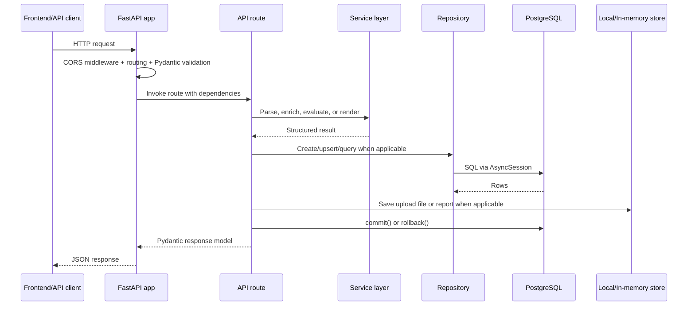

# 07 — API Reference

This document describes the HTTP API that is actually registered in `backend/app/main.py`. The default prefix is `/api/v1`; `/health` is registered directly on the app.

All successful endpoint responses use HTTP 200. FastAPI may also return its default 422 response for request-validation failures. There are no global exception handlers and no custom error envelope in use.

## Endpoint summary

| Method | Path | Function | Purpose |
|---|---|---|---|
| `GET` | `/health` | `backend/app/main.py::health_check` | Static liveness information. |
| `POST` | `/api/v1/jobs/analyze` | `backend/app/api/routes/jobs.py::analyze_job` | Analyze a job description and store the job. |
| `GET` | `/api/v1/jobs/{job_id}` | `backend/app/api/routes/jobs.py::get_job` | Retrieve a stored job analysis. |
| `POST` | `/api/v1/resumes/upload` | `backend/app/api/routes/resumes.py::upload_resumes` | Upload and parse one or more resumes. |
| `GET` | `/api/v1/resumes/{resume_id}` | `backend/app/api/routes/resumes.py::get_resume` | Retrieve a stored resume and parsed data. |
| `POST` | `/api/v1/matching/evaluate` | `backend/app/api/routes/matching.py::evaluate_matching` | Evaluate candidates and return ranked results. |
| `POST` | `/api/v1/reports/generate` | `backend/app/api/routes/reports.py::generate_report` | Generate a JSON or CSV report string. |
| `GET` | `/api/v1/reports/{report_id}` | `backend/app/api/routes/reports.py::get_report` | Retrieve a generated report from memory. |

There is no root `/` endpoint, no delete endpoint, and no route that reads stored screening results.

## Request lifecycle



Dependencies:

- Routes use `backend/app/db/session.py::get_db`, which yields an `AsyncSession`.
- Routes commit or roll back explicitly; `get_db` does not do so automatically.
- `backend/app/db/database.py::get_async_session` exists but is not used by routes.
- `CORS_ORIGINS` defaults to `http://localhost:3000` and `http://127.0.0.1:3000`; credentials are allowed, along with all methods and headers.

## `GET /health`

Returns static liveness information.

Response model: `backend/app/schemas/common.py::HealthResponse`

```json
{
  "status": "healthy",
  "version": "0.1.0",
  "app_name": "AI Resume Screening Backend"
}
```

The endpoint does **not** check PostgreSQL connectivity. `check_database_connectivity()` exists in `backend/app/db/database.py` but is not called by the live app.

## `POST /api/v1/jobs/analyze`

Request body: `backend/app/schemas/api.py::JobAnalysisRequest`

```json
{ "job_description": "..." }
```

Behavior in `analyze_job`:

1. Rejects blank or whitespace-only text with `400 Job description cannot be empty`.
2. Calls `backend/app/services/job_analysis_service.py::analyze_job_description`.
3. Validates the result as `AnalyzedJobDescription`.
4. Persists it through `JobRepository.create`, using `serialize_for_jsonb` for structured data.
5. Commits the session.

Success response: `JobAnalysisResponse`

```json
{
  "job_id": "<uuid>",
  "analysis": {
    "title": "...",
    "raw_text": "...",
    "required_skills": [],
    "preferred_skills": [],
    "qualifications": [],
    "experience_required": "Not specified",
    "structured_requirements": []
  }
}
```

Errors:

- `400` for empty text.
- `500 Failed to analyze job description` for exceptions during analysis or persistence; the original exception is logged.

## `GET /api/v1/jobs/{job_id}`

Path parameter: `job_id` as a UUID string.

Behavior in `get_job`:

- invalid UUID → `400 Invalid job ID format: '<job_id>'`
- missing job → `404 Job with ID '<job_id>' not found`
- rebuilds the response from `analysis_data`, overrides `structured_requirements` with `get_structured_requirements(job)`, and fills missing fields from dedicated `Job` columns.

Success response: `JobRetrieveResponse` with `job_id` and `analysis`.

## `POST /api/v1/resumes/upload`

Request: multipart form data with repeated field name `files`.

Behavior in `upload_resumes`:

- `MAX_FILE_SIZE_MB = 10`
- file name and non-empty content are required
- `document_service.validate_file` checks extension and size
- files are stored under `UPLOAD_STORAGE_DIR` with a UUID-based key
- text is extracted with PyMuPDF for PDFs or `python-docx` for DOCX
- `resume_parser_service.extract_all` extracts candidate fields
- `skill_service.extract_skills` adds technical and soft skills
- experience, project, and temporal enrichment is applied
- successful files are persisted with `ResumeRepository.create`, then committed

Per-file failures do **not** produce HTTP errors. They appear as entries with `status: "error"` and an `error` message, and the endpoint still returns 200 even if every file fails. Generic exceptions hide the detailed error from the client for safety.

Success response: `BatchResumeUploadResponse`

```json
{
  "total_files": 2,
  "successful": 1,
  "failed": 1,
  "results": [
    {
      "resume_id": "<uuid>",
      "filename": "candidate.pdf",
      "status": "success",
      "message": "...",
      "extraction": { "text": "...", "source_format": "pdf" },
      "candidate_info": { "name": "...", "email": "...", "phone": "...", "skills": [] },
      "error": null
    },
    {
      "resume_id": "",
      "filename": "bad.txt",
      "status": "error",
      "message": "Validation failed",
      "error": "..."
    }
  ]
}
```

The frontend maps these results back to selected files by array position.

## `GET /api/v1/resumes/{resume_id}`

Path parameter: `resume_id` as a UUID string.

Behavior in `get_resume`:

- invalid UUID → `400 Invalid resume ID format: '<resume_id>'`
- missing resume → `404 Resume with ID '<resume_id>' not found`
- reconstructs `DocumentExtractionResult` from stored text, `file_type`, and `candidate_info` keys `num_pages`, `is_scanned`, and `metadata`
- returns stored `candidate_info` as `ExtractedResumeInfo`

The `num_paragraphs` value extracted from DOCX files is not restored by this endpoint.

Success response: `ResumeRetrieveResponse` with `resume_id`, `filename`, `extraction`, and `candidate_info`.

## `POST /api/v1/matching/evaluate`

Request body: `backend/app/schemas/api.py::MatchingRequest`

```json
{
  "job_id": "<uuid>",
  "resume_ids": ["<uuid>", "<uuid>"],
  "use_semantic": true
}
```

Behavior in `evaluate_matching`:

- invalid job UUID → `400`; missing job → `404`
- duplicate resume IDs are removed with `list(dict.fromkeys(...))`
- invalid resume UUIDs are logged and skipped in the DB lookup but still appear as failed results
- missing resumes produce a zero-score candidate result with `error: "Resume not found"`
- each found resume is evaluated through `CandidateEvaluationService.evaluate_candidate`
- the route fixes `ScoringConfig(keyword_stuffing_education_aware=True, related_skill_credit_threshold=0.5)`
- successful results are upserted into `screening_results` and committed per candidate
- per-candidate exceptions produce a zero-score result with `error: "Matching process failed"`
- results are sorted by `overall_score` descending

Success response: `MatchingResponse`

```json
{
  "job_id": "<uuid>",
  "total_candidates": 2,
  "successful": 1,
  "failed": 1,
  "results": [
    {
      "resume_id": "<uuid>",
      "filename": "candidate.pdf",
      "candidate_name": "...",
      "match_result": {
        "overall_score": 73.5,
        "required_skill_coverage": 80.0,
        "preferred_skill_coverage": 60.0,
        "semantic_score": 75.0,
        "evidence_score": 70.0,
        "scoring_strategy": {}
      },
      "error": null
    }
  ]
}
```

`total_candidates` counts deduplicated input strings, including invalid or missing IDs. Frontend rank is the position in the sorted `results` array.

## `POST /api/v1/reports/generate`

This endpoint takes **query parameters**, not a JSON body. The `ReportRequest` schema exists in `backend/app/schemas/api.py` but is unused.

| Parameter | Required | Default | Allowed values |
|---|---|---|---|
| `job_id` | yes | — | UUID string |
| `resume_id` | yes | — | UUID string |
| `format` | no | `json` | `json` or `csv` |

Example:

```text
POST /api/v1/reports/generate?job_id=<uuid>&resume_id=<uuid>&format=csv
```

Behavior:

- invalid format → `400 Format must be either 'json' or 'csv'`
- invalid job/resume UUID → `400`
- missing job/resume → `404`
- evaluation uses the same `CandidateEvaluationService` and config as `/matching/evaluate`
- `use_semantic=True` is hardcoded for reports; there is no report semantic toggle
- content is produced by `report_service.generate_json_report` or `generate_csv_report`
- the report is saved in `backend/app/core/repository.py::report_repository`

Success response: `ReportResponse`

```json
{
  "report_id": "<uuid>",
  "format": "csv",
  "content": "Category, Metric / Field, Value\n..."
}
```

The content is a string in the JSON response, not a streamed file. Evaluation or rendering failures produce `500 Failed to generate report`.

## `GET /api/v1/reports/{report_id}`

Path parameter: `report_id` as a string. It is not UUID-validated.

Behavior:

- looks up `report_repository`
- missing report → `404 Report with ID '<report_id>' not found`
- returns the stored `format` and `content`

Reports are held only in process memory and disappear on backend restart.

## Important response schemas

Primary schema files are `backend/app/schemas/api.py`, `job.py`, `resume.py`, `matching.py`, and `common.py`.

| Schema | Important fields |
|---|---|
| `AnalyzedJobDescription` | `title`, `raw_text`, `required_skills`, `preferred_skills`, `qualifications`, `experience_required`, `structured_requirements` |
| `StructuredRequirement` | `requirement_type`, `data`, `original_text`; types include `REQUIRED`, `REQUIRED_GROUP`, `PREFERRED`, `OPTIONAL`, `EXPERIENCE`, `FUNDAMENTAL`; group modes `ANY` and `ALL` |
| `ExtractedResumeInfo` | `name`, `email`, `phone`, `education`, `experience`, `certifications`, `projects`, `skills` |
| `DocumentExtractionResult` | `text`, `source_format`, `num_pages`, `num_paragraphs`, `is_scanned`, `metadata` |
| `MatchResult` | `overall_score`, `tfidf_score`, `skill_match_score`, `explanation`, optional semantic score, skill lists, evidence fields, coverage fields, scoring strategy, strengths, gaps, temporal metadata |
| `ScoringStrategy` | `algorithm_version`, components, weights, configured weights, semantic status/availability/error/details, fallback flag, hierarchy/demonstration/stuffing flags, related-skill threshold, evaluation date |
| `CandidateMatchResult` | `resume_id`, `filename`, `candidate_name`, `match_result`, optional `error` |
| `ReportResponse` | `report_id`, `format`, `content` |

## API limitations

- No authentication or authorization.
- No rate limiting.
- No standardized error envelope; `ErrorResponse` is defined but unused.
- No endpoint to delete jobs, resumes, or screening results.
- No endpoint to list or read screening results.
- No endpoint to download the original uploaded file.
- `/health` is liveness only, not a database readiness check.
- Report storage is process-local.
- Upload status uses per-file records rather than HTTP failure codes.

Related implementation details are in [03 — Backend Internals](./03_BACKEND_INTERNALS.md) and [06 — Database Design](./06_DATABASE_DESIGN.md).
