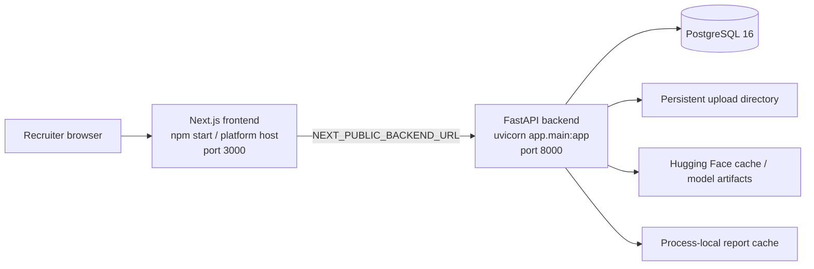

# 10 — Deployment and Operations

This chapter describes the deployment model documented in `README.md` and `DEPLOYMENT.md` and the operational boundaries visible in source. No deployment is performed by this documentation task.

## Current deployment model

HireLens has two independent runtime units:

1. **FastAPI backend** — a long-running Uvicorn process serving the API on port 8000.
2. **Next.js frontend** — a Node server or platform deployment serving the UI on port 3000.

The frontend is not served by FastAPI, and FastAPI is not served by Next.js. The browser connects to the backend using `NEXT_PUBLIC_BACKEND_URL`.

`docker-compose.yml` defines only PostgreSQL 16. There is no backend container, frontend container, Dockerfile, CI workflow, Makefile, or infrastructure-as-code definition in the reviewed source. Deployment is manual.



## Backend deployment

Documented production-style command from `backend/`:

```powershell
py -3.10 -m uvicorn app.main:app --host 0.0.0.0 --port 8000
```

Use `--reload` only in development.

Backend requirements come from `backend/requirements.txt`. Application settings are loaded by `backend/app/core/config.py::Settings` from environment variables and a `.env` file in the process working directory.

### Required backend configuration

| Variable | Deployment note |
|---|---|
| `APP_NAME`, `APP_VERSION` | Reported by `/health`. |
| `DEBUG` | Keep `false`; it also controls SQLAlchemy echo. |
| `API_PREFIX` | Default `/api/v1`; frontend client paths assume this. |
| `CORS_ORIGINS` | Must be a JSON array containing the deployed frontend origin exactly. |
| `POSTGRES_HOST`, `POSTGRES_PORT`, `POSTGRES_DB`, `POSTGRES_USER`, `POSTGRES_PASSWORD` | Used to build `DATABASE_URL`. |
| `TEST_DATABASE_URL` | Test-only; do not set in production. |
| `UPLOAD_STORAGE_DIR` | Point to a persistent, writable volume or absolute path. |
| `SEMANTIC_MODEL_NAME`, `SEMANTIC_MODEL_REVISION` | Optional overrides; pin and validate artifacts before use. |
| `HF_HOME`, `HF_HUB_OFFLINE`, `HF_HUB_DISABLE_TELEMETRY` | Hugging Face cache and download controls. |

`DATABASE_URL` is a computed property, not an environment variable. Setting an environment variable with that name is ignored because `Settings` uses `extra="ignore"`.

### Database migration step

Run Alembic as an explicit release step from `backend/`:

```powershell
py -3.10 -m alembic upgrade head
py -3.10 -m alembic current
```

Expected head: `add_structured_requirements`.

Application startup only calls `init_database()` to create the engine and session factory. It does not run migrations or create tables.

## Frontend deployment

From `frontend/`:

```powershell
npm ci
npm run lint
npx tsc --noEmit
npm run build
npm start -- -p 3000
```

`NEXT_PUBLIC_BACKEND_URL` is browser-visible and is embedded at build time for Next.js. Set it to the public backend origin before building. Do not put secrets in `NEXT_PUBLIC_*` variables.

The backend CORS configuration must include the deployed frontend origin. Local defaults of `http://localhost:3000` and `http://127.0.0.1:3000` are not sufficient for a deployed domain.

## Stateful resources

| Resource | Current implementation | Operational implication |
|---|---|---|
| Jobs, resumes, screening results | PostgreSQL tables | Durable if the database is backed up. |
| Uploaded files | Local filesystem at `UPLOAD_STORAGE_DIR` | Mount persistent storage; otherwise files are lost when the process/container is replaced. |
| Generated reports | In-memory `report_repository` | Lost on restart and not shared across workers. |
| Embedding caches | Process-local bounded caches | Each worker has its own cache; cold starts are slower. |
| Model artifacts | Local Hugging Face cache | Preload or mount `HF_HOME` for offline/reproducible deployment. |
| UI workflow state | React state | Exists only in the browser page session. |

## Health and readiness

`GET /health` returns static data:

```json
{
  "status": "healthy",
  "version": "0.1.0",
  "app_name": "AI Resume Screening Backend"
}
```

It does not check PostgreSQL, upload storage, or the semantic model. `check_database_connectivity()` exists in `backend/app/db/database.py` but is not called by the endpoint.

FastAPI documentation is available at `/docs` and `/redoc` when the backend is running. There is no root `/` endpoint.

## Manual post-deployment checks

`DEPLOYMENT.md` records a manual verification flow. A practical checklist derived from it is:

1. `GET /health` returns a healthy response.
2. `/docs` and `/redoc` load.
3. Analyze a synthetic JD through `POST /api/v1/jobs/analyze`.
4. Upload a small PDF or DOCX through `POST /api/v1/resumes/upload`.
5. Evaluate the job and resume through `POST /api/v1/matching/evaluate`.
6. Generate a JSON or CSV report through `POST /api/v1/reports/generate`.
7. Retrieve the report through `GET /api/v1/reports/{report_id}` in the same process.
8. Confirm the deployed frontend origin is allowed by CORS.
9. Confirm the upload directory is writable and persists across a process restart.

Because reports are in-memory, step 7 must use the same backend process that generated the report.

## Operational risks

- **No authentication or authorization.** Any client that can reach the API can use it.
- **No rate limiting or audit logging.** There is no request identity or abuse control.
- **Development defaults are unsafe for public use.** The default PostgreSQL password is `resume_dev_password`.
- **PostgreSQL port is published on all host interfaces** by Compose.
- **No TLS configuration is provided** in the repository.
- **Uploads are local files.** Multi-instance deployments need shared or object storage.
- **Reports are process-local.** Multi-worker deployments need durable report storage.
- **Health is liveness only.** It does not prove dependencies are ready.
- **No global exception handlers.** Errors are a mix of route-level `HTTPException`s and framework defaults.
- **Semantic runtime is environment-sensitive.** The README notes possible Windows torch DLL conflicts; preloading and pinned artifacts are recommended where semantic inference is required.
- **No CI/CD is defined.** Builds, tests, and deployment are manual.
- **No license file is present** in the reviewed repository.

## Recorded verification results

`README.md` and `backend/README.md` record:

- backend tests: **317 passed, 2 warnings** from dependency deprecations, with no skipped or weakened tests
- frontend: ESLint clean, TypeScript clean, and production build successful for `/` and `/_not-found`

These are repository-recorded results. No new deployment or test run was performed for this documentation task.

## Repository state note

The current working tree has the documentation directory untracked. Some README “known limitation” text describes an older dirty/deleted working-tree state and a GitHub handoff that does not match the present repository state. Treat the live source and `git status` as authoritative rather than that historical note.

## Production readiness summary

The current implementation is suitable for a controlled local or internal demonstration. Before unrestricted public use, the highest-priority gaps are authentication, persistent upload/report storage, backend/frontend containerization, real readiness checks, migration automation, TLS/network hardening, and a validated ranking benchmark. Those items are proposals in [12 — Future Improvements](./12_FUTURE_IMPROVEMENTS.md), not implemented capabilities.
